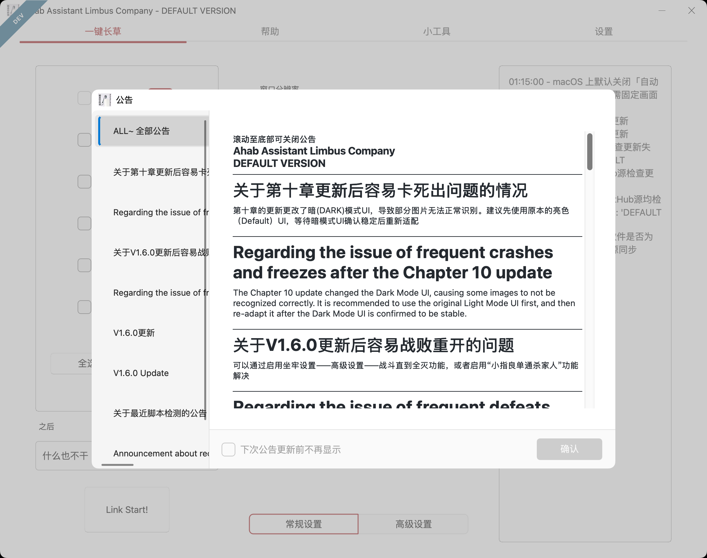

# AALC for macOS（macOS 分支）

上游项目：[KIYI671/AhabAssistantLimbusCompany](https://github.com/KIYI671/AhabAssistantLimbusCompany)（AGPL-3.0）。
本分支在保留上游业务代码的前提下，增加了一层 macOS 平台适配，让 AALC 能在 Apple Silicon
Mac 上从源码运行。

> 说明：上游 Release 只有 Windows(x86_64) 版本，官方 README 明确写到暂不支持 Mac/Linux。
> 本分支的上游基线 commit 见仓库首个提交的说明。



## 仓库与分支

| 项 | 值 |
|---|---|
| 上游 | [KIYI671/AhabAssistantLimbusCompany](https://github.com/KIYI671/AhabAssistantLimbusCompany) |
| 本分支 | [dingshengwei/AhabAssistantLimbusCompany `macos`](https://github.com/dingshengwei/AhabAssistantLimbusCompany/tree/macos)（已推送） |
| 基线 | 上游 `main` @ `e1d1749`（2026-10-19） |
| 本地目录 | `~/workspace/dshspace/AALC` |
| 开 PR | https://github.com/dingshengwei/AhabAssistantLimbusCompany/pull/new/macos |

与上游保持同步：

```bash
cd ~/workspace/dshspace/AALC
git fetch upstream
git merge upstream/main      # 冲突优先保留 module/platform 与 IS_MACOS 分支
git push origin macos
```

## 免费的游戏运行方式

MuMu Pro 是收费的，macOS 上可以完全免费跑起来，按推荐顺序：

| 方案 | 费用 | AALC 走哪条链路 | 适配度 |
|---|---|---|---|
| **Android Studio AVD**（推荐，已为你装好） | 完全免费开源 | adb（端口填 `0` 自动选设备） | 好：安卓版 16:9，可后台 |
| **PlayCover**（本机已装，但需要 IPA） | 免费开源 | 原生窗口（ScreenCaptureKit + CGEvent） | 实验性：需把窗口设成 16:9 |
| **BlueStacks Air** | 免费（可选购会员） | adb（端口 5555，需确认有 ADB 开关） | 好，安卓版 16:9 |
| ~~MuMu Pro~~ | 收费 | adb（端口 16384） | 好，但要花钱 |

**结论**：没有 IPA 就走 **AVD**（安卓版 + adb，免费且链路最稳）；有 IPA 且不想开模拟器再用 **PlayCover**（窗口必须 16:9）。

### PlayCover 方式（零安装成本）

1. PlayCover 里安装并启动 Limbus Company；
2. 打开 PlayCover 的「应用设置 → 显示」：
   - 窗口尺寸填 **1920 × 1080**（或用自定义分辨率），宽高比选 **16:9**
   - 关掉「悬浮窗 / 隐藏标题栏」之类会改变窗口尺寸的选项
3. AALC 设置里**不要**勾选「使用模拟器」，键鼠保持「前台」；
4. 首次运行 AALC 会通过 `CGWindowList` 找到窗口，并自动把本次会话的分辨率基准
   对齐到窗口高度（`cfg.set_win_size`，只改内存不落盘）。

> PlayCover 默认是 iPad 的 4:3 画布，AALC 的模板全部按 16:9 制作。窗口不是 16:9 时
> AALC 会在日志里告警并大概率识别失败，务必先按上面的方式改成 1920×1080。
> 若画面上下/左右出现黑边（应用内 letterbox），也需要在应用设置里改成拉伸/填充。

### Android Studio AVD（推荐，完全免费）

一条命令装好（SDK + emulator + Google Play arm64 镜像 + 竖屏 1080x1920 的 AVD）：

```bash
./scripts/setup_avd_macos.sh          # 约 3GB 下载，装到 ~/Library/Android/sdk
./scripts/start_avd_macos.sh          # 以后每次启动模拟器
```

然后在模拟器里：

1. 打开 Play 商店，登录 Google 账号；
2. 搜索安装 **Limbus Company**（免费），登录游戏账号；
3. 回到 Mac 终端确认设备在线：

```bash
~/Library/Android/sdk/platform-tools/adb devices
# emulator-5554   device
```

AALC 设置页：勾选「使用模拟器」→ 类型「其他」→ 主机 `127.0.0.1` → **端口填 `0`**。
端口为 0 表示「自动选择 adb 设备列表里的第一台」，AVD 和 USB 真机都这样用，不需要
`adb connect`。

```yaml
simulator: true
simulator_type: 10
simulator_host: 127.0.0.1
simulator_port: 0        # 0 = 自动选择；MuMu Pro 用户填 16384，TCP 设备填 5555
```

> 为什么 AVD 用竖屏 1080x1920：AALC 的触摸坐标是「竖屏设备 + 横屏游戏」的模型
> （`_scale` 会做一次旋转），和 MuMu 的行为一致。游戏横屏后截图仍是 1920x1080，
> 与模板基准吻合。

> minitouch 说明：Google Play 镜像从 Android 11 起不允许 shell 读 `/dev/input`，
> minitouch 起不来。本分支已自动退回 **`adb shell input`** 触摸后端（`shell_input.py`）：
> 点击/截图不受影响，拖拽与滑动慢一些（每条命令约 35ms），跑日常与镜牢够用。

### BlueStacks Air（免费，但 ADB 不确定）

BlueStacks Air 是 Apple Silicon 上的免费版本，但**官方设置里可能没有 ADB 开关**
（[第三方文档的说明](https://automationmacro.com/zh-CN/docs/bluestacks-setup-guide)）。
如果你的版本有「设置 → 高级 → Android Debug Bridge」，可以照用：端口一般是 `5555`，
AALC 里填 `127.0.0.1` + `5555`。没有这个开关就别折腾，直接用 AVD。

## 使用 PlayCover（实验性）

1. 用 PlayCover 安装并启动 Limbus Company，把窗口放在主屏、不要最小化。
2. AALC 设置页关闭「使用模拟器」，「键鼠操控方式」保持「前台」。
3. 首次运行 AALC 会尝试通过 `CGWindowList` 找到名为 `LimbusCompany` 的窗口。

已知限制：

- macOS 无法像 Win32 那样向非前台窗口投递消息，所以「后台点击」在 Mac 上等于前台点击。
- 窗口置顶/去边框/固定分辨率等 Win32 窗口样式操作在 macOS 上无效，
  「自动设置窗口」默认关闭。
- PlayCover 窗口是 iPad 比例，模板匹配容易偏，需要按实际分辨率重新校准图片资源。

## 已实现 / 未实现

已实现：

- `module.platform.macos`：窗口枚举与几何（Quartz）、窗口激活/移动/缩放（Accessibility）、
  窗口截图（ScreenCaptureKit，失败回退 `screencapture`）、鼠标键盘输入（CGEvent）、系统通知（osascript）。
- `module.platform.win32_compat`：在 macOS 上注入 `win32gui / win32con / win32api / win32ui /
  win32process / winreg / pywintypes / pyuac / win32crypt / win32com.client` 替身，
  上游业务代码不需要改 import。
- `main.py`：跳过 UAC 提权与 DPI 设置，安装兼容层并按平台调整默认配置。
- macOS 输入后端 `MacInput`（复用 pyautogui/CGEvent，中文输入走剪贴板 + Cmd+V）。
- 游戏启动：`open -a`（PlayCover / BlueStacks Air / MuMu Pro）。
- 通知：macOS 通知中心。

未实现 / 待办：

- PyInstaller `.app` / dmg 打包与签名、公证（下一步）。
- 自动更新：macOS 上直接跳过（上游更新包是 Windows exe/7z）。
- 关机/休眠/锁屏、开机自启、任务计划等 Windows 专属功能。
- 模拟器的“一键启动/多开管理”（上游依赖 Windows 注册表与 MuMuManager.exe；BlueStacks Air / AVD 需手动启动）。
- 性能：当前每次截图重新创建 ScreenCaptureKit 会话（约 200 ms），后续可复用 `SCStream` 降到 10 ms 级。

## 目录结构（新增部分）

```
module/platform/
├── __init__.py            # IS_MACOS / IS_WINDOWS 等平台标志
├── macos/
│   ├── display.py         # 显示器信息、Retina 缩放、Win32 坐标换算
│   ├── window.py          # CGWindowList / AX：查找、几何、激活、移动
│   ├── capture.py         # ScreenCaptureKit 截图（+ screencapture 回退）
│   ├── input.py           # MacInput：CGEvent 点击/拖拽/滚动/按键
│   ├── notify.py          # osascript 通知
│   └── bootstrap.py       # 兼容层安装、权限检查、macOS 默认配置
└── win32_compat/          # win32* 模块替身（只在 darwin 上注入）
```

## 与上游同步

```bash
git remote add upstream git@github.com:KIYI671/AhabAssistantLimbusCompany.git  # 已配置
git fetch upstream
git merge upstream/main     # 解决冲突时优先保留 module/platform 与 IS_MACOS 分支
```

移植改动尽量收敛在 `module/platform/`、`main.py` 少量平台分支、以及
`screenshot.py / automation.py / game.py / utils.py / check_update.py / windows_toast.py / hdr.py`
里的 `IS_MACOS` 判断，便于跟随上游合并。

## 许可

上游为 AGPL-3.0，本分支同样遵循 AGPL-3.0，分发时需保留版权与许可声明。
